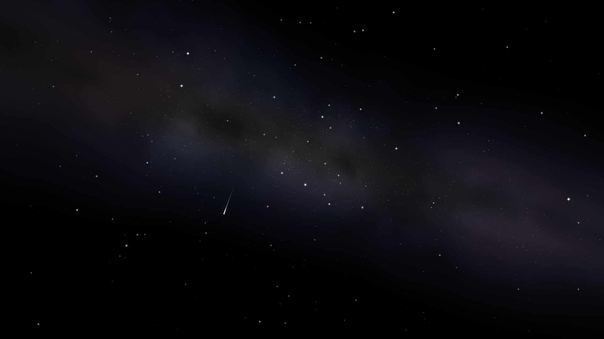

# Starry Sky

Mod Minecraft **NeoForge 1.21.1**, **uniquement côté client**, qui embellit le ciel étoilé la nuit.

Il ne fait rien d'autre : pas de blocs, pas d'items, pas de gameplay, seulement le rendu du ciel.



*Aperçu avec les réglages par défaut. Cette image vient du banc d'essai des shaders du mod (mêmes shaders et même
génération d'étoiles, hors du jeu) : ce n'est pas une capture d'écran prise dans Minecraft.*

## Ce que fait le mod

- **Plus d'étoiles** (1500 par défaut, contre environ 800 visibles dans le jeu de base), de **tailles variées** :
  beaucoup d'étoiles faibles et quelques étoiles brillantes, plus grosses.
- **Étoiles rondes et douces** (cœur lumineux + léger halo) au lieu des petits carrés de base, toujours nettes :
  une étoile ne descend jamais sous quelques pixels, donc elle ne clignote pas quand le ciel tourne.
- **Éclats en croix** discrets sur les quelques étoiles les plus brillantes.
- **Légères variations de couleur** : blanc, bleuté, jaune pâle.
- **Voie lactée** (optionnelle) : une bande lumineuse traverse le ciel en diagonale, avec ses nuages, sa traînée
  sombre, ses nuances bleues, violettes et dorées, et des milliers de poussières d'étoiles.
- **Apparition progressive au crépuscule et disparition à l'aube**, en suivant exactement la luminosité des étoiles
  du jeu de base (`level.getStarBrightness(partialTick)`). La Voie lactée, plus pâle, n'apparaît qu'en pleine nuit.
- **Rotation avec le ciel** : même rotation que le soleil et la lune.
- **Masquées par la pluie** (`level.getRainLevel(partialTick)`), comme les étoiles de base.
- **Atténuation près de l'horizon** (extinction atmosphérique).
- **Scintillement léger** (optionnel), avec un très léger chatoiement de couleur, calculé sur la carte graphique.
- **Étoiles filantes occasionnelles** (optionnelles), avec une traînée douce et une tête brillante.
- **Vraies constellations** : Orion, la Grande Ourse, Cassiopée, le Cygne et la Lyre, avec leurs vraies étoiles
  (Bételgeuse, Rigel, Véga, Deneb…). À la longue-vue, des pointillés relient les étoiles de la constellation visée.
- **Planètes** (optionnelles) : Vénus (près de l'horizon au crépuscule ou à l'aube), Mars, Jupiter et Saturne.
  Brillantes, sans scintillement, elles se déplacent d'une nuit à l'autre.
- **Pluies d'étoiles filantes** (optionnelles) : environ une nuit sur dix, annoncées au crépuscule.
- **Comètes** (optionnelles) : environ une fois toutes les 24 nuits, une comète reste visible 5 nuits. Elle a un
  noyau brillant, une chevelure verdâtre et deux queues qui pointent toujours à l'opposé du soleil : une queue de
  poussières dorée, large et courbée, et une queue d'ions bleue, fine et droite. Elle grandit, atteint son maximum au
  milieu de son passage puis s'efface, et dérive un peu d'une nuit à l'autre. Chaque comète a son nom (« C/1 Sélène »)
  et peut être observée à la longue-vue.
- **Éclipses de lune** (optionnelles) : une pleine lune sur trois, la lune passe dans l'ombre de la Terre autour de
  minuit. Elle s'assombrit puis devient rouge cuivré pendant la totalité (« lune de sang »), son halo rougit, et le
  ciel plus noir fait mieux ressortir les étoiles et la Voie lactée.
- **Annonces au crépuscule** : une éclipse, une comète ou une pluie d'étoiles filantes est annoncée à la tombée de
  la nuit.
- **Lune ronde** : la lune carrée de Minecraft est remplacée par une lune ronde et lisse, avec ses mers, un léger halo
  et ses 8 phases. C'est une texture : elle s'applique même si le mod est désactivé dans la config, et un pack de
  ressources qui modifie la lune passe devant.
- **Halo de lune** (optionnel) : une lueur bleutée autour de la lune, plus forte à la pleine lune. La pleine lune
  pâlit aussi un peu les étoiles et la Voie lactée.
- **Nuages effacés la nuit** (optionnel) : ils s'estompent progressivement au crépuscule et reviennent à l'aube,
  mais restent quand il pleut ou neige. Avec Sodium, le masquage en pleine nuit marche toujours ; le fondu dépend
  de la version de Sodium.
- **Aurores boréales** (optionnelles) : la nuit, dans les biomes froids (plaines enneigées, taïga enneigée, pics de
  glace, océans gelés…), des rideaux de lumière verte, turquoise et violette ondulent vers le nord. Elles apparaissent
  et disparaissent en fondu (4 secondes) quand on entre dans un biome froid ou qu'on en sort, et sont cachées par
  les chutes de neige. Chaque nuit est différente : faible, normale ou intense, et parfois un orage magnétique
  aux rideaux rouges et roses. Le climat est évalué au niveau de la mer : un simple sommet enneigé ne suffit pas.
- **Observation à la longue-vue** (optionnelle) : la nuit, viser une étoile brillante avec la longue-vue de
  Minecraft affiche un viseur qui se resserre sur l'étoile et un panneau avec son nom, sa constellation, sa classe
  spectrale, sa magnitude, sa distance et sa température. Environ 330 étoiles sont identifiables, dont les ~60 plus
  brillantes portent le nom d'une vraie étoile (Sirius, Véga, Rigel…). Le ciel du mod est imaginaire : ces noms ne
  correspondent pas aux vraies positions. Dans la longue-vue, les étoiles grossissent un peu et gagnent en éclat.
- **Carnet d'observation** (touche **J**, modifiable dans Options → Commandes) : chaque étoile ou planète gardée un
  court instant au centre de la longue-vue y est enregistrée, avec un carillon et un badge « Nouvelle découverte ».
  Un compteur indique la progression (par exemple 23 / 342). Le carnet est sauvegardé sur ton ordinateur, un par
  monde solo ou par serveur, dans `.minecraft/starrysky/journal/`. Les comètes observées y restent, même quand
  elles ont quitté le ciel.
- **Succès d'astronome** (onglet « Succès » du carnet, touche **Tab** pour changer d'onglet) : 11 succès avec une
  notification dans le style des progrès de Minecraft. Première lumière (1 astre), Astronome amateur (25), Astronome
  confirmé (100), Tour du système solaire (les 4 planètes), Relier les points (une constellation complète),
  Cartographe céleste (toutes les constellations), Chasseur de comètes, Lune de sang (regarder la lune pendant une
  éclipse totale), Faites un vœu (une pluie d'étoiles filantes), Danse des aurores et Maître des étoiles (tous les
  astres). Ils sont enregistrés avec le carnet, un par monde.
- Les étoiles de base de Minecraft sont masquées là où le mod est actif (optionnel).
- Actif uniquement dans l'**Overworld** par défaut : le Nether et l'End restent inchangés.

## Installation

1. Installer **NeoForge 21.1.x** pour Minecraft **1.21.1** (21.1.266 ou plus récent).
2. Copier `starrysky-1.0.0.jar` dans le dossier `mods` de l'instance Minecraft.
3. Lancer le jeu.

Le mod est **uniquement côté client** :

- il n'y a **rien à installer sur le serveur** ;
- on peut **rejoindre un serveur qui n'a pas le mod** ;
- installé par erreur sur un serveur dédié, il ne charge aucun code.

## Paramètres

Les paramètres se règlent en jeu : **Mods → Starry Sky → Config**. Ils s'appliquent immédiatement, sans redémarrer.
Ils sont aussi enregistrés dans `config/starrysky-client.toml`.

| Paramètre | Type | Défaut | Plage | Description |
|---|---|---|---|---|
| `enabled` | booléen | `true` | — | Active ou désactive le mod. |
| `starCount` | entier | `1500` | 100 – 10000 | Nombre d'étoiles. La Voie lactée ajoute en plus deux fois ce nombre en poussières d'étoiles (15000 au maximum). |
| `starSize` | décimal | `1.0` | 0.25 – 3.0 | Multiplicateur de taille des étoiles. |
| `brightness` | décimal | `1.0` | 0.1 – 2.0 | Luminosité globale. |
| `coloredStars` | booléen | `true` | — | Variations de couleur (blanc, bleuté, jaune pâle). |
| `twinkle` | booléen | `true` | — | Scintillement léger. |
| `twinkleSpeed` | décimal | `1.0` | 0.1 – 5.0 | Vitesse du scintillement. |
| `shootingStars` | booléen | `true` | — | Étoiles filantes occasionnelles. |
| `shootingStarFrequency` | entier | `5` | 0 – 20 | Nombre moyen d'étoiles filantes par minute par nuit claire (0 = aucune). |
| `milkyWay` | booléen | `true` | — | Voie lactée (lueur diffuse + poussières d'étoiles). |
| `auroras` | booléen | `true` | — | Aurores boréales dans les biomes froids. |
| `planets` | booléen | `true` | — | Vénus, Mars, Jupiter et Saturne. |
| `meteorShowers` | booléen | `true` | — | Pluie d'étoiles filantes environ une nuit sur dix. |
| `moonHalo` | booléen | `true` | — | Halo autour de la lune. |
| `comets` | booléen | `true` | — | Comète visible quelques nuits, de temps en temps. |
| `eclipses` | booléen | `true` | — | Éclipses de lune (une pleine lune sur trois). |
| `hideCloudsAtNight` | booléen | `true` | — | Nuages effacés progressivement la nuit (sauf pluie). |
| `telescope` | booléen | `true` | — | Infos des étoiles en visant avec la longue-vue. |
| `hideVanillaStars` | booléen | `true` | — | Cache les étoiles de base de Minecraft. |
| `dimensions` | liste | `["minecraft:overworld"]` | — | Dimensions où le mod est actif. Seules les dimensions avec un ciel « normal » sont concernées. |

Pour un ciel plus spectaculaire, monter `starCount` (jusqu'à 10000) et `brightness` : le coût reste très faible.

## Performances

Le mod est conçu pour ne pas faire ralentir le jeu, y compris sur une carte graphique intégrée :

- **Rien n'est régénéré à chaque image.** Les étoiles et la Voie lactée sont calculées une seule fois, avec une
  graine fixe, puis stockées sur la carte graphique. Elles ne sont reconstruites que si `starCount`, `coloredStars`
  ou `milkyWay` change. La taille, la luminosité, le scintillement et la rotation sont gérés par les shaders :
  les modifier ne reconstruit rien.
- **Aucune texture, aucun calcul de bruit par pixel.** Les nuages de la Voie lactée sont calculés une fois sur le
  processeur et enregistrés dans la couleur des sommets d'un maillage.
- **Peu d'appels de dessin** par image (lueur, halo, aurores, étoiles, planètes, étoiles filantes, plus deux les nuits
  de comète), et aucun objet créé pendant le rendu (pas de travail supplémentaire pour le ramasse-miettes de Java).
  Le maillage de la comète (quelques centaines de sommets) n'est reconstruit qu'une fois par minute de jeu.
- **Rien n'est dessiné** le jour, sous la pluie battante, ni pour les étoiles situées sous l'horizon.

Ordres de grandeur mesurés dans le banc d'essai des shaders (navigateur, 1920×1080, carte intégrée Intel UHD) —
ce ne sont pas des mesures prises dans Minecraft :

| Élément | Coût par image |
|---|---|
| Étoiles (1500 + poussières de la Voie lactée) | environ 0,1 ms |
| Étoiles au maximum (10000 + 15000 poussières, taille ×3) | environ 0,4 ms |
| Lueur de la Voie lactée, quand elle remplit l'écran | environ 0,5 à 1 ms |
| Lueur de la Voie lactée, quand on regarde ailleurs | environ 0,1 à 0,3 ms |

À titre de comparaison, une image à 60 images par seconde dure 16,7 ms. La lueur de la Voie lactée est l'élément le
plus coûteux, car elle couvre une grande partie de l'écran : si le jeu ralentit quand on regarde le ciel la nuit,
désactiver `milkyWay` en premier. La construction initiale des maillages prend une fraction de seconde, une seule
fois, à l'entrée dans le monde.

## Compiler le mod

### Avec GitHub Actions (sans rien installer)

Le workflow `.github/workflows/build.yml` compile le mod à chaque push.

1. Envoyer le projet sur un dépôt GitHub (GitHub Desktop, `git push`, ou glisser-déposer le dossier dans
   « Add file → Upload files » sur github.com). Les dossiers `build/`, `.gradle/` et `run/` ne doivent pas être envoyés.
2. Onglet **Actions** → workflow **Build** : il se lance tout seul après le push
   (ou bouton **Run workflow** pour le relancer).
3. Une fois le run terminé (coche verte), télécharger l'artefact **starrysky-jar** en bas de la page du run :
   c'est un zip qui contient `starrysky-1.0.0.jar`.

### En local

Prérequis : un JDK 17 ou plus récent pour lancer Gradle (le projet utilise Gradle 9.2.1), et environ 2 Go d'espace
disque libre pour le premier build (Minecraft, NeoForge, JDK 21). Le mod est compilé en Java 21 : si aucun JDK 21
n'est installé, Gradle en télécharge un automatiquement.

```bash
./gradlew build       # produit build/libs/starrysky-1.0.0.jar
./gradlew runClient   # lance Minecraft avec le mod en développement
```

Sous Windows, utiliser `gradlew.bat` à la place de `./gradlew`.

## Organisation du code

```
src/main/java/fr/evan/starrysky/
├── StarrySky.java                 Point d'entrée (@Mod, dist = CLIENT) : config, écran de config, événements
├── config/StarrySkyConfig.java    Paramètres (ModConfigSpec, type CLIENT)
├── render/SkyRenderHandler.java   Rendu pendant RenderLevelStageEvent (AFTER_SKY) : visibilité, rotation, état OpenGL
├── render/StarField.java          Génération des étoiles (graine fixe) dans un VertexBuffer statique
├── render/MilkyWay.java           Modèle de la Voie lactée et maillage statique de sa lueur
├── render/ShootingStars.java      Étoiles filantes
├── render/AuroraBorealis.java     Maillage statique des aurores boréales
├── render/Constellations.java     Vraies constellations (étoiles et traits)
├── render/Planets.java            Planètes
├── render/MoonHalo.java           Halo de lune
├── render/Comet.java              Comètes (noyau, chevelure, queues de poussières et d'ions)
├── render/LunarEclipse.java       Éclipses de lune (dates et teinte de la lune)
├── telescope/Achievement.java     Succès du carnet (objectifs et progression)
├── telescope/AchievementToast.java  Notification de succès
├── telescope/ObservationJournal.java  Carnet d'observation (sauvegarde locale)
├── telescope/JournalScreen.java   Écran du carnet
├── mixin/OptionsMixin.java        Nuages masqués en pleine nuit
├── mixin/SodiumCloudRendererMixin.java  Fondu des nuages avec Sodium (ignoré sans Sodium)
├── render/StarShaders.java        Chargement des shaders
├── telescope/StarCatalog.java     Catalogue des étoiles brillantes (noms, classes, distances…)
├── telescope/TelescopeTargeting.java  Étoile visée à la longue-vue
├── telescope/TelescopeHud.java    Viseur et panneau d'information
└── mixin/LevelRendererMixin.java  Masque les étoiles de base (voir ci-dessous)

src/main/resources/assets/starrysky/
├── shaders/core/star.*            Étoiles : taille en pixels, forme ronde, éclats, scintillement, horizon
├── shaders/core/milky_way.*       Lueur de la Voie lactée
├── shaders/core/shooting_star.*   Étoiles filantes
├── shaders/core/aurora.*          Aurores boréales (ondulation, rayons, dégradé de couleurs)
├── textures/gui/sprites/telescope Icônes pixel-art du panneau (blanches, teintées à l'affichage)
└── lang/en_us.json, fr_fr.json    Traductions (description du mod, écran de config, options et infobulles)
```

Les traductions de l'écran de configuration suivent les clés de NeoForge :
`starrysky.configuration.<option>` pour le libellé et `starrysky.configuration.<option>.tooltip` pour l'infobulle
(la plage autorisée est ajoutée automatiquement par NeoForge). La description du mod dans la liste des mods est
traduite via `fml.menu.mods.info.description.starrysky`.

## Note technique : les mixins

`OptionsMixin` masque les nuages en pleine nuit, `LevelRendererMixin` (et `SodiumCloudRendererMixin` avec Sodium)
gère leur fondu. En 1.21.1, l'opacité des nuages est écrite dans leur maillage : le fondu multiplie donc l'alpha de la
couleur du shader juste avant que le maillage soit dessiné. `LevelRendererMixin` teinte aussi la lune pendant les
éclipses, juste avant qu'elle soit dessinée. Tous sont facultatifs : s'ils ne peuvent pas s'appliquer, le jeu ne plante pas.

`LevelRendererMixin` sert aussi à **masquer les étoiles de base**. Elles sont dessinées au milieu de
`LevelRenderer#renderSky` depuis un tampon privé, et NeoForge n'a pas d'événement pour les désactiver.

Le mixin remplace par `0` la valeur de `getStarBrightness()` **uniquement à l'endroit où `renderSky` décide de dessiner
les étoiles**, ce qui saute leur dessin. Le soleil, la lune et le reste du jeu ne sont pas touchés.
Si un autre mod réécrit `renderSky` et que le mixin ne peut pas s'appliquer, le jeu ne plante pas : les étoiles de base
restent simplement visibles en plus de celles de Starry Sky.

## Pourquoi pas `displayTest` dans `neoforge.mods.toml` ?

La clé `displayTest` (par exemple `IGNORE_ALL_VERSION`) a été supprimée dans NeoForge 20.5 : NeoForge 1.21.1 ne la lit
plus. Désormais, client et serveur ne comparent que les canaux réseau déclarés par les mods. Starry Sky n'en déclare
aucun, donc il est automatiquement compatible avec n'importe quel serveur, avec ou sans le mod.

## Compatibilité

- Les shaders type Iris/Oculus remplacent tout le rendu du ciel : Starry Sky n'aura en général aucun effet visible avec
  un pack de shaders actif.
- Les mods qui remplacent entièrement le ciel de l'Overworld peuvent entrer en conflit visuel ; désactiver alors
  `hideVanillaStars` ou le mod.
